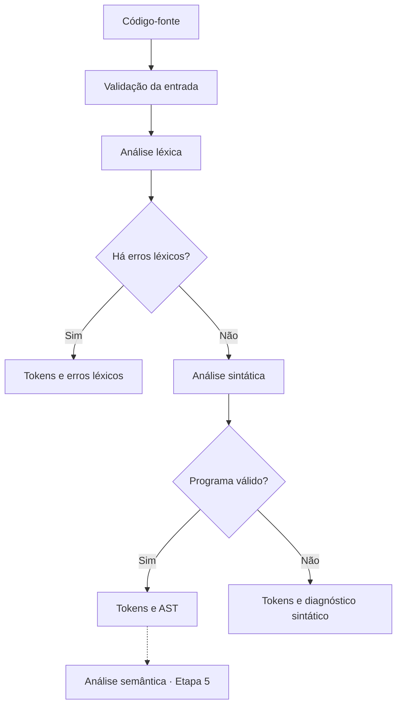

# Materiais e Métodos da Etapa 4

A aplicação usa Python e Flask no backend, JavaScript no frontend e Docker Compose para executar o serviço web e a API. O scanner da Etapa 3 fornece a sequência de tokens e suas posições. O parser descendente recursivo é escrito em Python e organiza as funções por construção da gramática. Nas expressões, cada nível de precedência chama o nível mais forte e agrupa os operadores binários da esquerda para a direita. A implementação manual permite relacionar as funções às produções em EBNF e emitir mensagens ligadas à construção em leitura. A estratégia exige regras adequadas à análise descendente e limites de aninhamento.

A tabela de tokens conserva a ordem linear do código. Uma árvore de derivação mostraria a aplicação das produções, incluindo símbolos gramaticais intermediários. A AST simplifica a representação para mostrar atribuições, operadores, valores e blocos. Parênteses afetam o agrupamento e o intervalo do nó, sem introduzir um nó próprio.

Os nós sempre têm `tipo`, `filhos` e posição. Programa e bloco listam comandos. Atribuição contém identificador e expressão. Condicional contém condição, bloco verdadeiro e, quando presente, bloco alternativo. Operações e comparações trazem `operador` e seus operandos. Identificadores têm `nome` e literais têm `valor` textual, preservando a grafia. Linha e coluna começam em 1. Os campos `inicio` e `fim` são offsets em pontos de código com fim exclusivo, assim como a posição final `linha_final` e `coluna_final` marcam o fim exclusivo.

A avaliação cobre a aceitação de cada construção, a rejeição das combinações inválidas, a forma da AST em casos de precedência e associatividade, a consistência das posições com o scanner, a resposta da API e o comportamento da interface. Os diagnósticos indicam o primeiro erro sintático, o elemento encontrado e o esperado. Na presença de erro léxico, o parser é pulado para evitar diagnósticos sobre uma sequência incompleta.

Para a demonstração, envie `resultado = 10 + 5 * 2`, compare a tabela de tokens com a árvore e expanda a atribuição e a adição para localizar a multiplicação. Depois envie `resultado = (10 + 5` para mostrar o parêntese esperado e a posição do diagnóstico. Envie `resultado = 10 @` para mostrar o diagnóstico léxico e os tokens preservados.
